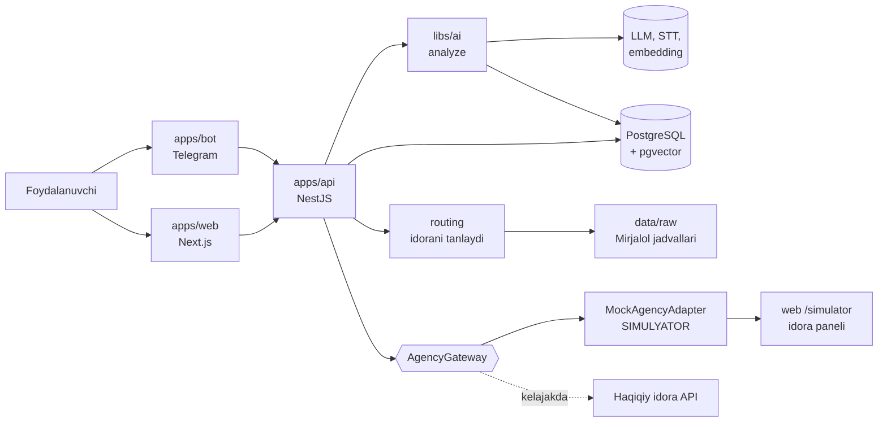

# Arxitektura

## Murojaat yo'li

1. **Bot yoki veb** foydalanuvchi matnini `POST /cases/{id}/messages` ga yuboradi.
2. **API** `POST /cases/{id}/analyze` da `libs/ai` dagi `analyze()` ni chaqiradi.
3. **analyze()**: tozalash → xavf filtri → qonun qidiruvi → tasnif → tahlil → tekshiruvchi. Natija `AnalysisResult` sxemasiga mos bo'lishi shart.
4. **routing**: qizil xavf → favqulodda; kichik holat xaritada bo'lsa → tekshirilgan yo'l; bo'lmasa → umumiy yo'l.
5. Foydalanuvchi rozilik bersa, **POST /appeals** → `AgencyGateway` → hozircha simulyator.
6. Simulyator holatni taymer bo'yicha o'zgartiradi (`DEMO_SPEED`).

## Chegaralar (kim nimaga javobgar)

| Chegara | Kelishuv |
| --- | --- |
| API ↔ AI | `analyze(input): Promise<AnalysisResult>` — `libs/contracts/src/index.ts` |
| API ↔ bot/veb | `libs/contracts/openapi.yaml` (mock: `pnpm mock`) |
| API ↔ idoralar | `AgencyGateway` interfeysi — haqiqiy API kelganda faqat adapter almashadi |
| API ↔ huquqiy ma'lumot | `data/raw/*.csv` → `data/import` tekshiruvi |

## Xavfsizlik

- Idora ro'yxati faqat `agencies.csv` dan; AI ro'yxatda yo'q idorani nomlay olmaydi.
- Moddalar faqat qidiruvda topilgan `source_id` lardan; qolganini tekshiruvchi o'chiradi.
- Ishonch 0.6 dan past bo'lsa — yuristga yo'naltirish.
- API kalitlari faqat serverdagi `.env` da.
