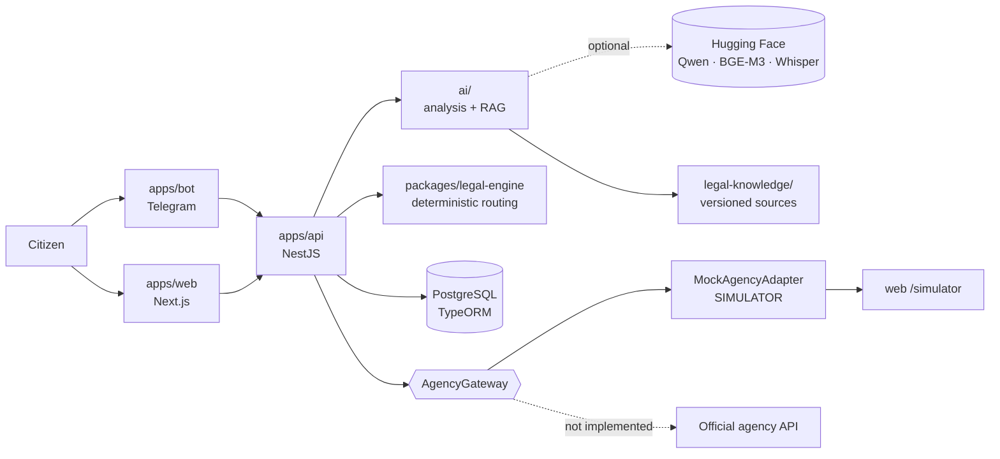

# System overview

LEX-DISPATCHER is an AI-assisted legal action navigator for Uzbekistan. It is a
modular monolith in a pnpm monorepo: one NestJS API, two clients, and shared
TypeScript packages.

## Components

| Component | Path | Responsibility | Must not |
| --- | --- | --- | --- |
| Web client | `apps/web` | Chat UI, results, simulator panel (Next.js) | Call AI directly; decide routing |
| Telegram bot | `apps/bot` | Same flow over Telegram | Submit without the consent button |
| API | `apps/api` | HTTP boundary, orchestration, validation, persistence | Let AI output bypass validation |
| Shared contracts | `packages/contracts` | zod schemas + TS types for every cross-boundary payload | Contain logic |
| Legal engine | `packages/legal-engine` | Deterministic rules → `RoutingDecision` | Call an LLM, network, clock or randomness |
| AI | `ai/` | `analyze()`: normalize, risk keywords, retrieval, classification, citation validation; model providers; prompts | Choose agencies; invent citations |
| Legal knowledge | `legal-knowledge/` | Source documents with verification metadata | Hold unreviewed content marked `VERIFIED` |
| Data import | `data/` | Team spreadsheets (agencies, test cases) + CSV validator | Contain personal data |

## API modules (`apps/api/src`)

| Module | Responsibility | Status |
| --- | --- | --- |
| `health` | `GET /health` liveness | Done |
| `cases` | Case lifecycle; orchestrates analysis → routing | In-memory storage |
| `ai-analysis` | Wraps `@lex/ai` `analyze()` | Offline stub pipeline |
| `legal-knowledge` | Source registry for RAG and citations | Placeholder (empty) |
| `legal-routing` | Wraps `@lex/legal-engine` | Placeholder rules (PENDING) |
| `action-plans` | Action plans and application drafts | Placeholder |
| `agency-gateway` | Consent-gated `POST /submissions`; simulator view | Mock adapter only |
| `case-tracking` | `GET /submissions/:id` status | Basic |
| `database` | TypeORM config + entities; connects only if `DATABASE_URL` set | Entities defined, not yet used by services |

## Key design decisions

- **AI advises, rules decide.** The AI returns an `AnalysisResult`; only the
  legal engine produces a `RoutingDecision`. See [data-flow.md](data-flow.md).
- **Contracts are runtime-validated.** AI output and every request body are
  parsed with the zod schemas from `@lex/contracts`.
- **Mock-only agency integration.** `AgencyGateway` has one implementation,
  `MockAgencyAdapter` (`adapterType: "MOCK"`). No real government API is integrated.
- **No microservices.** One API process; modules are separated by NestJS module
  boundaries and package boundaries. See [ADR-001](../decisions/ADR-001-monorepo.md).

Related: [data-flow.md](data-flow.md) · [security.md](security.md) · [contracts](../api/contracts.md)
